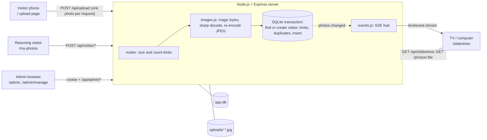
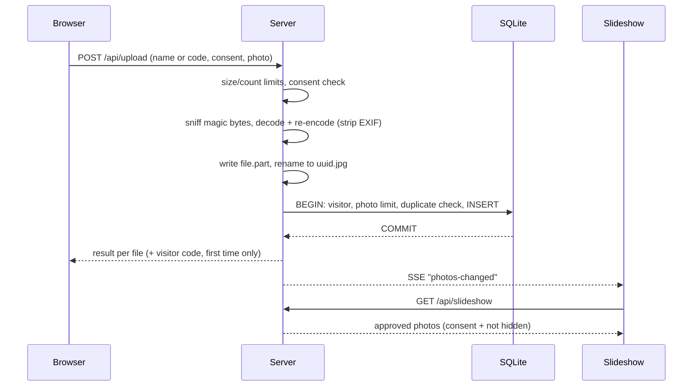
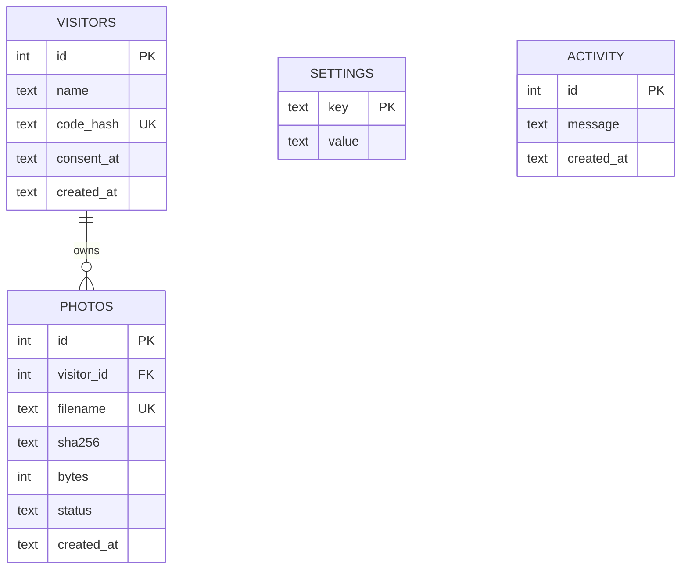

# Architecture

## Technology choices
See the table in [README.md](README.md). In one sentence: a single Node.js/Express process serves the pages and a JSON API, stores data in one SQLite file plus an `uploads/` folder, and pushes live updates to the slideshow with Server-Sent Events.

Rejected on purpose: React/Vue (brief requires vanilla JS), WebSockets (SSE is enough for one-way updates), PostgreSQL/Redis (more to install and explain; SQLite handles an event-sized load), cloud object storage (extra accounts and keys), user accounts/e-mail login (collects personal data we do not need).

## System diagram


## Upload sequence


## Data model

- `PHOTOS(visitor_id, sha256)` is UNIQUE — the database itself prevents duplicate entries.
- `ON DELETE CASCADE`: deleting a visitor deletes their photo rows (files are removed by the server).
- `status` is `approved` or `hidden` (admin moderation). A photo is public only if `status='approved'` **and** the visitor's `consent_at` is not NULL.
- `SETTINGS` holds `durationSeconds` and `showNames`. `ACTIVITY` is a capped log (last 200 rows) for the dashboard.

## Project structure
```
server/   index.js (start-up, .env)   app.js (routes)   db.js (schema)
          images.js (validation)      auth.js (admin cookie)   events.js (SSE)
public/   index.html status.html my-photos.html slideshow.html 404.html
          css/app.css (design system)  css/slideshow.css
          js/common.js (theme, icons, toasts, dialogs)  js/<page>.js
views/    admin.html manage.html login.html   (served only through guarded routes)
tests/    api.test.js (28 API tests)   e2e.js (37 browser checks)
docs/     TEST_RESULTS.md  screenshots/
data/     app.db + uploads/  (created at run time, ignored by Git)
```

## Security measures (where each lives)
| Risk | Measure |
|---|---|
| Malicious / fake files | magic-byte check + full decode + re-encode (`images.js`); random UUID filenames; originals never stored |
| Oversized uploads | multer limits → HTTP 413; pixel limit |
| Public access to hidden/deleted photos | photos are served by a route that checks the database (not a static folder) |
| Path traversal | file name must match `^[a-f0-9-]{36}\.jpg$` |
| XSS | all user text rendered with `textContent`; strict CSP (`script-src 'self'`, no inline styles) |
| Admin access | signed HttpOnly SameSite=Strict cookie, constant-time password check, rate-limited login, same-origin check on writes |
| Code guessing | ~50-bit codes, hashed at rest, lookup rate limit |
| Race conditions | single synchronous SQLite transaction; UNIQUE constraints; temp-file-then-rename |
