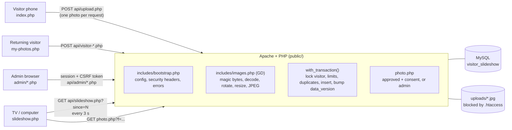
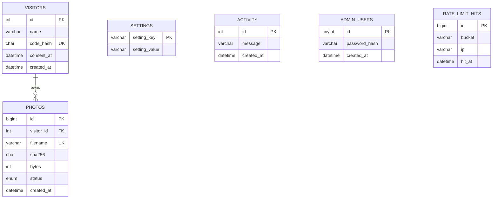

# Architecture (PHP + MySQL)

## Technology choices
- **Core PHP 8**, one small script per endpoint — easy to read top-to-bottom and to explain in a viva. Shared code sits in `includes/`.
- **MySQL/MariaDB via PDO** with real prepared statements (`ATTR_EMULATE_PREPARES = false`): user input is never pasted into SQL. InnoDB gives transactions, row locks and foreign keys.
- **GD** for images: decode (proves it is a real picture), rotate, resize, re-encode as JPEG (removes GPS/EXIF).
- **Polling** for live updates (reasons in ASSUMPTIONS.md).
- **Apache + XAMPP**; no extra services, no Composer, no npm.

## System diagram


## Upload sequence
```mermaid
sequenceDiagram
  participant B as Browser
  participant P as PHP (upload.php)
  participant G as GD
  participant D as MySQL
  participant T as Slideshow page
  B->>P: POST photos[] + consent + name or code
  P->>P: rate limit, size/count limits, consent check
  P->>G: validate + clean each file
  G-->>P: new JPEG written to name.jpg.part
  P->>P: rename .part to .jpg
  P->>D: BEGIN; SELECT visitor FOR UPDATE (or INSERT visitor)
  P->>D: limit check, duplicate check, INSERT photos, bump data_version; COMMIT
  P-->>B: result per file (+ code, first time only)
  T->>P: GET slideshow.php?since=N (every 3 s)
  P-->>T: changed -> approved photo list
```

## Data model

- `PHOTOS(visitor_id, sha256)` UNIQUE → duplicates impossible. `ON DELETE CASCADE` → deleting a visitor removes their rows (files are deleted by PHP afterwards).
- Image **files are not stored in MySQL**; only `filename` (random 32 hex characters + `.jpg`).
- `status` is `approved` or `hidden`. A photo is public only if `approved` **and** `visitors.consent_at` is not NULL.
- `SETTINGS`: `duration_seconds`, `show_names`, and `data_version` (a counter that rises on every change; the slideshow polls it).
- `ADMIN_USERS`: at most one row (`id` = 1) with a `password_hash()` value.

## Request flow in a nutshell
1. Every script starts with `includes/bootstrap.php` (config, helpers, DB, auth, security headers, error handler).
2. **Pages** (`public/*.php`) print the shared `<head>` (`page_head()`), static HTML, and one script file. All data comes from the **API** (`public/api/*.php`) as JSON.
3. **API** scripts: check the method → rate limit → validate input → prepared statements/transaction → `json_out()`.
4. **Admin** scripts additionally call `require_admin_post()` (session + same-origin + CSRF) or `require_admin_get()`.

## Security measures
| Risk | Measure |
|---|---|
| SQL injection | PDO prepared statements; sort columns come from a whitelist |
| Fake/malicious files | magic bytes + type + extension agreement, full GD decode, re-encode, random file names, pixel limit |
| Direct access to photos | `uploads/` denied by `.htaccess`; `photo.php` checks the database; file name must match `^[a-f0-9]{32}\.jpg$` |
| Path traversal | file names are never taken from the request |
| XSS | JavaScript uses `textContent`; PHP output uses `h()`; strict Content-Security-Policy (no inline scripts/styles) |
| CSRF | admin writes need the session's token in a header + same-origin check; SameSite=Strict cookie |
| Session attacks | HttpOnly cookie, strict mode, new id on login, idle timeout |
| Brute force | per-IP rate limits (login, code lookup, uploads) stored in MySQL |
| Secrets | `config.local.php` is git-ignored; admin password only as a hash; visitor codes only as hashes |
| Race conditions | InnoDB transaction + `FOR UPDATE` + UNIQUE constraints + `.part` rename |
| Config exposure | `config/`, `includes/`, `tests/`, `docs/`, `*.sql`, `*.md`, `.git` blocked by `.htaccess` |
